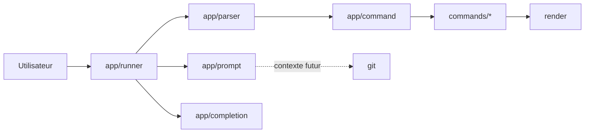

# Architecture

## Vue d'ensemble

Terminal Rust est actuellement un binaire Rust unique. Son architecture sépare
la boucle interactive, l'analyse des entrées, le dispatch des commandes, la
logique métier et le rendu.



## Responsabilités actuelles

| Module | Responsabilité | Ne doit pas devenir |
| --- | --- | --- |
| `main.rs` | Composition minimale et code de sortie | Un second runner |
| `app/runner.rs` | Modes interactif/non interactif, historique, cycle de vie | Un catalogue de commandes |
| `app/parser.rs` | Transformation d'une ligne en arguments | Un exécuteur |
| `app/command.rs` | Registre, validation simple et dispatch | Un module métier géant |
| `app/completion.rs` | Complétion des commandes et chemins | Une copie du registre |
| `app/prompt.rs` | Construction et affichage du prompt | Un client Git monolithique |
| `commands/` | Comportement des commandes internes | Du code d'interface interactive |
| `errors/` | Erreurs métier affichables | Des effets de bord |
| `git/` | Détection et futur contexte Git | Un wrapper de toutes les commandes Git |
| `render/` | Sorties standard et erreurs | De la logique métier |
| `utils/` | Helpers génériques et limités | Un dossier fourre-tout |

## Flux d'une commande

1. `runner` lit une ligne avec `rustyline` ou depuis l'entrée standard.
2. `parser` produit une liste d'arguments.
3. `command` cherche la commande dans son registre et valide le nombre maximal
   d'arguments.
4. Le module métier exécute l'opération.
5. `render` écrit la sortie ; `runner` garde la session active après une erreur
   récupérable.

## Architecture cible

Les dossiers vides déjà présents (`core`, `platform`, `config`, `cache`,
`diagnostics`, `cli`) représentent des frontières possibles, pas une obligation
de migration immédiate. Une évolution doit entrer dans ces dossiers uniquement
quand une responsabilité concrète le justifie.

Le moteur de prompt cible suivra le pipeline suivant :

```text
configuration -> collecte du contexte -> segments -> rendu -> terminal
```

La collecte et le rendu resteront séparés afin de tester les segments sans
terminal réel et de désactiver proprement les fonctions indisponibles.

## Contraintes

- Démarrage et commandes de base fonctionnels sans Git.
- Aucun chemin ou shell propre à un OS dans la logique partagée.
- Pas de lecture réseau dans le prompt.
- Une commande externe lente ne doit pas bloquer durablement chaque affichage.
- Les erreurs de décoration ne doivent jamais rendre le shell inutilisable.
