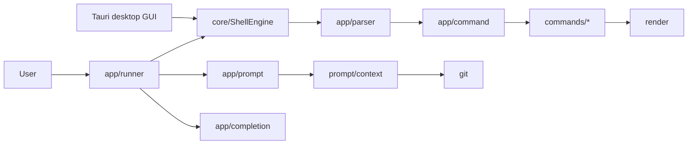

# Architecture

## Overview

Terminal Rust ships a Rust library and a thin CLI binary. The architecture
separates the interactive lifecycle, reusable engine API, parsing, dispatch,
business logic and rendering.



## Current responsibilities

| Module | Responsibility | Must not become |
| --- | --- | --- |
| `lib.rs` | Stable library boundary and public exports | A duplicate engine |
| `main.rs` | Minimal CLI runner call | A second runner |
| `app/runner.rs` | Interactive/non-interactive modes, history and lifecycle | A command catalog |
| `core/engine.rs` | Shared execution contract, output, errors and directory changes | A terminal UI |
| `app/parser.rs` | Convert a line into arguments | An executor |
| `app/command.rs` | Registry, basic validation and dispatch | A large domain module |
| `app/completion.rs` | Command and path completion | A duplicate registry |
| `app/prompt.rs` | Prompt construction | A monolithic Git client |
| `commands/` | Built-in command behavior | Interactive UI code |
| `errors/` | Presentable domain errors | Side effects |
| `git/` | Git context and read-only shortcuts | An unrestricted Git passthrough |
| `render/` | Standard and error output | Business logic |
| `desktop/src-tauri/` | Current Tauri adapter, PTY sessions and native settings | A second shell engine |
| `desktop/src/` | Current xterm presentation, tabs and accessible controls | Generic system access |
| `desktop/native-prototype/` | Reversible native UI/PTY experiment | Production desktop support before migration gates pass |

## Command flow

1. `runner` reads a line through `rustyline` or standard input.
2. `ShellEngine` captures standard output and error separately.
3. `parser` produces arguments.
4. `command` resolves the registry entry and validates the argument limit.
5. The domain module performs the operation.
6. The engine returns a typed `ExecutionResult` with output, error, current
   directory and any directory change.
7. The CLI or GUI chooses presentation; recoverable errors keep the session alive.

## Target direction

New module boundaries are introduced only when a concrete responsibility needs
them. The prompt pipeline is:

```text
configuration -> context collection -> segments -> rendering -> terminal
```

Collection and rendering remain separate so segments can be tested without a
real terminal and unavailable capabilities can disappear safely.

Extensions stay behind a versioned, permission-based boundary. Commands,
segments, completions and themes may be extension points; `ShellEngine`, PTY
handles and Tauri objects are not public plugin API. Declarative formats and a
local registry come before any isolated code runtime. In-process Rust dynamic
libraries are not the default because they couple ABI and crash risk to the host.

## Constraints

- Startup and core commands work without Git.
- Shared logic contains no OS-specific shell or path assumptions.
- Prompt rendering performs no network reads.
- Slow external commands cannot block every prompt indefinitely.
- Decoration failures never make the shell unusable.
