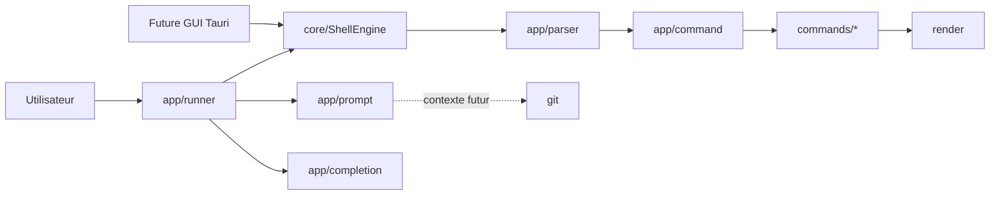

# Architecture

## Vue d'ensemble

Terminal Rust fournit une bibliothèque Rust et un binaire CLI mince. Son
architecture sépare la boucle interactive, l'API de moteur réutilisable,
l'analyse des entrées, le dispatch des commandes, la logique métier et le
rendu.



## Responsabilités actuelles

| Module | Responsabilité | Ne doit pas devenir |
| --- | --- | --- |
| `lib.rs` | Frontière de bibliothèque et exports publics stables | Une copie du moteur |
| `main.rs` | Appel minimal du runner CLI | Un second runner |
| `app/runner.rs` | Modes interactif/non interactif, historique, cycle de vie | Un catalogue de commandes |
| `core/engine.rs` | Contrat d'exécution partagé, sorties, erreurs et changement de dossier | Une interface terminal ou GUI |
| `app/parser.rs` | Transformation d'une ligne en arguments | Un exécuteur |
| `app/command.rs` | Registre, validation simple et dispatch | Un module métier géant |
| `app/completion.rs` | Complétion des commandes et chemins | Une copie du registre |
| `app/prompt.rs` | Construction et affichage du prompt | Un client Git monolithique |
| `commands/` | Comportement des commandes internes | Du code d'interface interactive |
| `errors/` | Erreurs métier affichables | Des effets de bord |
| `git/` | Détection, contexte Git et raccourcis en lecture seule | Un passthrough Git sans liste blanche |
| `render/` | Sorties standard et erreurs | De la logique métier |
| `utils/` | Helpers génériques et limités | Un dossier fourre-tout |

## Flux d'une commande

1. `runner` lit une ligne avec `rustyline` ou depuis l'entrée standard.
2. `ShellEngine` reçoit la ligne et capture séparément stdout et stderr.
3. `parser` produit une liste d'arguments.
4. `command` cherche la commande dans son registre et valide le nombre maximal
   d'arguments.
5. Le module métier exécute l'opération.
6. Le moteur retourne un `ExecutionResult` avec statut typé, sorties, erreur,
   dossier courant et éventuel changement de dossier.
7. Le consommateur CLI ou GUI décide comment présenter ce résultat ; le runner
   CLI garde la session active après une erreur récupérable.

## Architecture cible

Les dossiers encore vides (`core`, `platform`, `config`, `diagnostics`, `cli`)
représentent des frontières possibles, pas une obligation de migration
immédiate. `cache` contient désormais le cache court du contexte Git du prompt.
Une évolution doit entrer dans ces dossiers uniquement quand une responsabilité
concrète le justifie.

Le moteur de prompt cible suivra le pipeline suivant :

```text
configuration -> collecte du contexte -> segments -> rendu -> terminal
```

La collecte et le rendu resteront séparés afin de tester les segments sans
terminal réel et de désactiver proprement les fonctions indisponibles.

## Contraintes

- Démarrage et commandes de base fonctionnels sans Git.
- Aucun chemin ou shell propre à un OS dans la logique partagée.
- Pas de lecture réseau dans le prompt.
- Une commande externe lente ne doit pas bloquer durablement chaque affichage.
- Les erreurs de décoration ne doivent jamais rendre le shell inutilisable.
